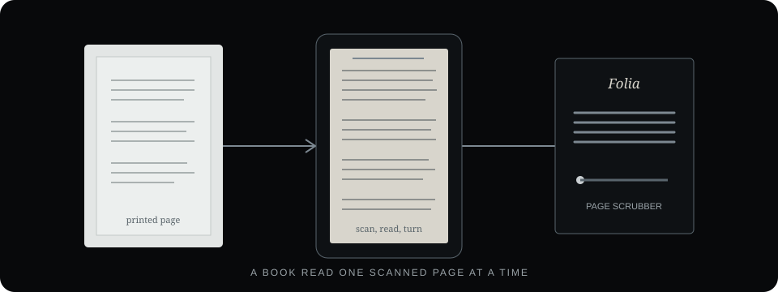

<div align="center">

<picture>
  <source media="(prefers-reduced-motion: reduce)" srcset="assets/banner.webp">
  
</picture>

<br/>


<br/>

<a href="https://react.dev"></a>
<a href="https://www.typescriptlang.org"></a>
<a href="https://vite.dev"></a>


<br/>


<br/><br/>

*A quiet, mobile-first way to read a book as it was printed: one scanned page at a time.*

<br/>

[Overview](#overview) · [Reading](#reading) · [Features](#features) · [Architecture](#architecture) · [Pages](#page-images) · [Design](#design) · [Getting started](#getting-started) · [Deployment](#deployment)

</div>

---

<a id="overview"></a>
##  Overview

**Folia** is Atramenth’s sister project for a book that lives in its scanned pages. Where Atramenth presents the printed text as a digital reader, Folia lets the original page images speak for themselves: paper, ink, margins and all.

The viewer is built to read slowly and comfortably:

- **Page by page.** Open a scan and move through the book with a real sliding track.
- **Made for touch.** Swipe to turn; pinch or double tap to zoom; drag to inspect a page.
- **Quiet by design.** Slate and Paper themes, Cormorant Garamond with Jost, and controls that stay out of the way.
- **Your place stays yours.** No account or backend. Folia remembers progress and bookmarks on the device.

The live site will be [atramenth.github.io/folia](https://atramenth.github.io/folia/) after deployment.



---

<a id="reading"></a>
##  Reading

| Action | How |
|---|---|
| Turn a page | Swipe, use the previous and next controls, or press the arrow keys / Page Up and Page Down |
| Zoom | Pinch, double tap, or use the mouse wheel; drag to pan |
| Find a page | Open **Go to page**, enter its number, or jump by section |
| Move through a long book | Drag the scrubber; slide upward while dragging to slow down for precise placement |
| Bookmark a page | Press **B** or use the bookmark control |
| Start a slideshow | Press **Space** or use the playback control; choose 3, 5, 8 or 12 seconds per page |
| Reset zoom | Press **0** |
| Full screen | Press **F** |

Each page has its own address, such as `#/p/812`. Folia restores the last reading position when you return.

---

<a id="features"></a>
##  Features

- Sliding page track with edge resistance and flick momentum
- Pinch, double tap and wheel zoom, with drag-to-pan
- Long-book scrubber designed for precise navigation across 1,200 pages
- Go to page, section jumps, and 10-page or 100-page steps
- Bookmarks and a saved reading position
- Slideshow at 3, 5, 8 or 12 seconds per page, with a progress line
- Hash deep links, for example `#/p/812`
- Preloads the next two pages and previous page; respects the device’s Save Data setting
- Slate, Paper and Auto themes
- Reduced motion, keyboard controls and screen-reader labels

---

<a id="architecture"></a>
##  Architecture



Folia is built with React and TypeScript, using object-oriented services and controllers. Vite produces a static site for GitHub Pages; at runtime the only library dependency is React.

- **Catalog:** `src/data/catalog.ts` defines the ordered sections and printed page ranges. The viewer, section labels, scrubber, jump sheet and page check share this source.
- **Gestures:** `StageController` handles swipe, pinch, pan, double tap and wheel input. `ScrubModel` controls precision while scrubbing.
- **Services:** Stores persist settings, progress and bookmarks. `PageImages` resolves image URLs and preloads nearby pages; `HashLocation` follows the current page; `Slideshow` advances on a timer.
- **Interface:** `Stage`, `Slide`, `Scrubber`, `JumpSheet` and `SettingsSheet` make up the reader.

---

<a id="page-images"></a>
##  Page images

The book contains 1,221 page images, named by printed page number. The configured sections are:

| Section | Printed pages |
|---|---:|
| Book | 1–1196 |
| Introduction | 1199–1220 |
| Index | 1221–1223 |

Pages 1197 and 1198 are intentionally absent. The page catalog expects filenames in the form `1.avif`, `2.avif`, and so on, without zero padding. The page checker reports missing or unexpected files; strict mode also exits with an error when files are missing.

```bash
npm run check:pages
npm run check:pages:strict
```

---

<a id="design"></a>
##  Design



Folia shares Atramenth’s restrained visual language: flat Slate and Paper themes, measured typography and quiet controls. Cormorant Garamond carries the editorial character; Jost keeps interface labels clear. The page scan remains the focus.

---

<a id="accessibility"></a>
##  Accessibility and privacy

- Keyboard controls cover page turns, slideshow, page navigation, bookmarks, zoom and full screen.
- Screen-reader labels identify controls and reading state.
- Reduced-motion preferences are respected.
- The current page, bookmarks, settings and progress are stored locally on the device.
- No account or backend is required.

---

<a id="getting-started"></a>
##  Getting started

**Requirements:** Node.js and npm.

```bash
npm install
npm run dev
```

Open the local address printed by Vite. To start at a page, use a hash route such as `http://localhost:5173/#/p/812`.

```bash
npm run check:pages   # report missing or unexpected page images
npm run build         # type check and production build into dist/
npm run preview       # serve the production build locally
```

---

<a id="deployment"></a>
##  Deployment



The project is published at **https://atramenth.github.io/folia/** through `.github/workflows/deploy.yml`. Push to `main` to build and publish with GitHub Actions. In repository settings, choose **Settings → Pages → Build and deployment → GitHub Actions** as the source.

The app uses a relative Vite base path and hash routes, so it can be hosted beneath a repository path without a 404 redirect.

---

<a id="structure"></a>
##  Project structure

```
folia/
├── assets/                  README artwork, badges and diagrams
├── public/pages/            Scanned book pages, named by printed page number
├── scripts/check-pages.ts   Reports missing and unexpected page images
├── src/
│   ├── data/catalog.ts      Ordered sections and printed page ranges
│   ├── domain/              PageCatalog and ScrubModel
│   ├── gestures/            StageController
│   ├── services/            Stores, page images, hash location and slideshow
│   ├── hooks/               useStore and useViewer
│   ├── components/          Stage, Slide, Scrubber and settings sheets
│   └── styles/app.css       Design tokens, layout and themes
├── .github/workflows/       GitHub Pages deployment
├── index.html
├── package.json
└── vite.config.ts
```

---

<div align="center">



</div>


